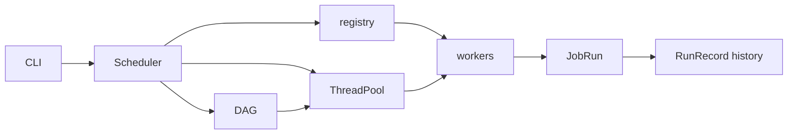

# schd

[](https://github.com/joyfranky2309/schd/actions/workflows/ci.yml)

`schd` is a C++20 DAG-based scheduler that runs shell and optional pricing jobs through a priority-aware thread pool. It skips failed dependency branches, retries failed jobs, keeps an in-memory attempt history, and optionally persists completed runs to SQLite.

## System overview



- `Job` is the reusable job definition; `JobRun` is the state snapshot for one attempt.
- `DAG` owns dependency edges, readiness, and skipped-node state.
- `ThreadPool` executes jobs and returns ready or skipped work to `Scheduler`.
- Priority is determined by category, user priority, and insertion sequence. EOD outranks ADHOC.
- A scheduler latch synchronizes `wait()` with callback state updates.
- Attempts are numbered from the existing history for that job plus one.

## Locked design decisions

- **Job and JobRun are separate:** `Job` is reusable; each attempt gets a fresh `JobRun` snapshot.
- **The DAG owns edges:** jobs do not track their own dependency state.
- **Priority is deterministic:** category, user priority, and insertion sequence decide queue order.
- **Scheduler state is protected by one queue mutex:** DAG indegree updates and ready-queue pushes occur under `ThreadPool::queue_mutex_`.
- **Execution runs outside the queue lock:** workers release the queue lock before `Job::execute()`.
- **Completion state is callback-owned:** callbacks return ready/skipped work rather than calling public pool methods.
- **SQLite writes have no scheduler locks:** `HistoryStore` is used only after `Scheduler::wait()` on the CLI main thread.

## AutoSys comparison

- When a job fails, `schd` skips its transitive dependents and records the failed ancestor; independent jobs continue.
- Every attempt, status, exit code, and message is retained in attempt history.
- Compared with the incumbent, `schd` lacks file watchers, calendars/cron, agents, alerting, container-native job execution, and stdout/stderr capture.

## Quick start

Install the optional SQLite development library, then use `run.sh` for a SQLite-enabled build:

```sh
sudo apt-get install -y libsqlite3-dev
./run.sh validate examples/etl.json
./run.sh run examples/etl.json
./run.sh run examples/etl.json --db my.db
./run.sh history my.db --limit 5
```

With no arguments, `./run.sh` runs `examples/pricing.json`:

```sh
./run.sh
```

Set `SCHD_BUILD_DIR` to choose another build directory:

```sh
SCHD_BUILD_DIR=build-custom ./run.sh validate examples/etl.json
```

## Using job files

Create a JSON file such as `jobs.json`, validate it, and run it:

```sh
./run.sh validate jobs.json
./run.sh run jobs.json --db my.db
```

Example shell DAG:

```json
{
  "workers": 7,
  "jobs": [
    {
      "id": "extract",
      "type": "shell",
      "command": "echo extract",
      "category": "EOD",
      "priority": 5,
      "max_attempts": 3
    },
    {
      "id": "load",
      "type": "shell",
      "command": "echo load",
      "category": "EOD",
      "depends_on": ["extract"]
    }
  ]
}
```

Built-in CPU pricing job:

```json
{
  "jobs": [
    {
      "id": "cpu-price",
      "type": "cpu_pricing",
      "category": "EOD",
      "params": {
        "face_value": 100.0,
        "coupon_rate": 0.05,
        "maturity_years": 5,
        "yield": 0.05,
        "settlement_date": "2024-01-02"
      }
    }
  ]
}
```

Optional QuantLib jobs can be enabled with `-DSCHD_WITH_QUANTLIB=ON` and `libquantlib0-dev`. `issue_date` is optional, must precede `settlement_date`, and defaults to three months before settlement. QuantLib evaluation-date mutation is process-global and pricing is serialized with a mutex.

## Exit codes

- `0`: all jobs succeeded
- `1`: one or more jobs failed
- `2`: invalid input, missing database, or invalid command-line option

## SQLite history

```sh
./run.sh history my.db --limit 5
./run.sh history my.db --job extract
./run.sh history my.db --job extract --limit 20
```

`--db` opens the database before the run and writes records after `wait()` returns. History is stored in a single transaction for each run. It is saved only after the run finishes: a crash mid-run loses that run, and there is no crash recovery.

A missing database passed to `history` does not create it. Builds without `SCHD_WITH_SQLITE` reject `--db` and `history` with exit code 2.

## Manual build

Release build:

```sh
cmake -S . -B build -DCMAKE_BUILD_TYPE=Release
cmake --build build --parallel
ctest --test-dir build --output-on-failure
```

SQLite build:

```sh
sudo apt-get install -y libsqlite3-dev
cmake -S . -B build-sqlite -DCMAKE_BUILD_TYPE=Release -DSCHD_WITH_SQLITE=ON
cmake --build build-sqlite --parallel 1
ctest --test-dir build-sqlite --output-on-failure
```

Sanitizer builds:

```sh
cmake -S . -B build-asan -DCMAKE_BUILD_TYPE=Release -DSCHD_ASAN=ON
cmake --build build-asan --parallel
ctest --test-dir build-asan --output-on-failure

cmake -S . -B build-tsan -DCMAKE_BUILD_TYPE=Release -DSCHD_TSAN=ON
cmake --build build-tsan --parallel
ctest --test-dir build-tsan --output-on-failure --repeat until-fail:20
```

`SCHD_ASAN` and `SCHD_TSAN` are mutually exclusive.

## Benchmark and Docker

The benchmark uses 1,000 in-process jobs across 20 fixed-seed layers. It compares no-op jobs with 1 ms sleep jobs over five-run median timings.

```sh
cmake -S . -B build -DCMAKE_BUILD_TYPE=Release
cmake --build build --target schd_bench --parallel
./build/schd_bench
```

Measured on WSL2 with 12 logical processors on 2026-11-25:

| variant | workers | wall ms | jobs/sec | speedup vs 1 worker | scheduling overhead us/job |
|---|---:|---:|---:|---:|---:|
| no-op | 1 | 1.625 | 615364.9 | 1.000 | 1.625 |
| no-op | 2 | 4.228 | 236544.4 | 0.384 | 4.228 |
| no-op | 4 | 4.807 | 208014.3 | 0.338 | 4.807 |
| no-op | 7 | 5.837 | 171333.6 | 0.278 | 5.837 |
| sleep-1ms | 1 | 1245.356 | 803.0 | 1.000 | - |
| sleep-1ms | 2 | 626.845 | 1595.3 | 1.987 | - |
| sleep-1ms | 4 | 306.114 | 3266.8 | 4.068 | - |
| sleep-1ms | 7 | 169.549 | 5898.0 | 7.345 | - |

No-op jobs are slower with more workers because each microsecond-scale completion contends for the scheduler lock. Sleep jobs scale closer to linearly because execution time dominates lock overhead.

A Docker image packages the CLI and `/bin/sh` for shell jobs:

```sh
docker build --build-arg WITH_QUANTLIB=OFF --build-arg WITH_SQLITE=OFF -t schd .
docker run --rm -v "$PWD/examples:/jobs:ro" schd validate /jobs/etl.json
docker run --rm -v "$PWD/examples:/jobs:ro" schd run /jobs/etl.json
```

Running jobs as containers is not supported.

## Limitations

- SQLite history is saved only after a run finishes; crash recovery is not implemented.
- Retries are immediate; there is no backoff delay.
- There are no cron or calendar triggers, file watchers, agents, alerting, or REST API.
- Execution is limited to a single process.
- Shell jobs have no timeout or captured stdout/stderr redirection.
- QuantLib support is optional; without it, core and CPU-pricing jobs remain available.
