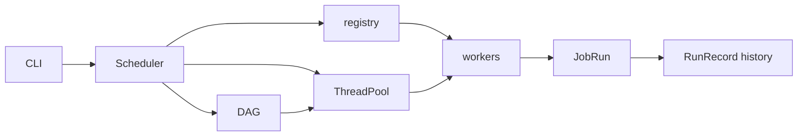

# schd

[](https://github.com/joyfranky2309/schd/actions/workflows/ci.yml)

`schd` is a C++20 DAG-based scheduler that runs shell and optional pricing jobs through a priority-aware thread pool, skips only failed dependency branches, retries failed jobs immediately, and keeps an in-memory audit trail of every attempt.



## Locked design decisions

- **Job and JobRun are separate:** `Job` is the reusable definition, while each attempt gets a fresh `JobRun` snapshot.
- **Inheritance is intentionally narrow:** subclasses implement only `execute()`; dependency and status rules remain shared.
- **The DAG owns edges:** jobs have no dependency state, and `DAG` owns readiness and skipped-node state.
- **Priority has three tiers:** category, user priority, then insertion sequence provide deterministic FIFO ordering within a tier; EOD outranks ADHOC.
- **One scheduler lock protects schedule state:** indegree updates and ready-queue pushes occur in `ThreadPool::queue_mutex_`.
- **Runs are queued, not popped, with timestamps:** `JobRun` enters `QUEUED` at push time, making queue wait measurable.
- **Attempt numbers are derived:** an attempt is the number of existing run records for that job plus one.

## AutoSys comparison

- When a job fails, `schd` skips its transitive dependents and records the failed ancestor; independent jobs continue running.
- `schd` records the status, exit code, and message for every attempt.
- Compared with the incumbent, `schd` lacks file watchers, calendars/cron, agents, alerting, container support, and stdout/stderr capture.

## Build

Release:

```sh
cmake -S . -B build -DCMAKE_BUILD_TYPE=Release
cmake --build build --parallel
ctest --test-dir build --output-on-failure
```

AddressSanitizer plus UndefinedBehaviorSanitizer:

```sh
cmake -S . -B build-asan -DCMAKE_BUILD_TYPE=Release -DSCHD_ASAN=ON
cmake --build build-asan --parallel
ctest --test-dir build-asan --output-on-failure
```

ThreadSanitizer:

```sh
cmake -S . -B build-tsan -DCMAKE_BUILD_TYPE=Release -DSCHD_TSAN=ON
cmake --build build-tsan --parallel
ctest --test-dir build-tsan --output-on-failure --repeat until-fail:20
```

`SCHD_ASAN` and `SCHD_TSAN` are mutually exclusive.

QuantLib is optional:

```sh
sudo apt-get install -y libquantlib0-dev
cmake -S . -B build-quantlib \
  -DCMAKE_BUILD_TYPE=Release \
  -DSCHD_WITH_QUANTLIB=ON
cmake --build build-quantlib --parallel
ctest --test-dir build-quantlib --output-on-failure
```

For vcpkg, add `-DCMAKE_TOOLCHAIN_FILE=$HOME/projects/vcpkg/scripts/buildsystems/vcpkg.cmake`.

## Run

```sh
./build/schd run jobs.json
./build/schd run jobs.json --workers 4
./build/schd run jobs.json --verbose
./build/schd validate jobs.json
```

Shell example:

```json
{
  "workers": 7,
  "jobs": [
    {
      "id": "extract",
      "type": "shell",
      "command": "echo extract",
      "category": "EOD",
      "priority": 5,
      "max_attempts": 3
    },
    {
      "id": "load",
      "type": "shell",
      "command": "echo load",
      "category": "EOD",
      "depends_on": ["extract"]
    }
  ]
}
```

Built-in CPU pricing example:

```json
{
  "jobs": [
    {
      "id": "cpu-price",
      "type": "cpu_pricing",
      "category": "EOD",
      "params": {
        "face_value": 100.0,
        "coupon_rate": 0.05,
        "maturity_years": 5,
        "yield": 0.05,
        "settlement_date": "2024-01-02"
      }
    }
  ]
}
```

Optional QuantLib bond pricing example:

```json
{
  "jobs": [
    {
      "id": "bond-price",
      "type": "quantlib_bond",
      "category": "EOD",
      "params": {
        "face_value": 100.0,
        "coupon_rate": 0.05,
        "maturity_years": 5,
        "yield": 0.05,
        "issue_date": "2023-10-02",
        "settlement_date": "2024-01-02"
      }
    }
  ]
}
```

`issue_date` is optional, must be strictly before `settlement_date`, and defaults to three months before it. QuantLib's evaluation date is process-global, so QuantLib pricing is serialized with a mutex.

## Benchmark

The benchmark uses 1,000 in-process jobs in 20 layers, with 50 jobs per layer and 1–3 dependencies from the previous layer. It uses a fixed seed and five runs per configuration, reporting the median. No-op jobs and 1 ms sleep jobs are both benchmarked.

Measured on the repository machine with `hardware_concurrency: 12` on 2026-11-25.

| variant | workers | wall ms | jobs/sec | speedup vs 1 worker | scheduling overhead us/job |
|---|---:|---:|---:|---:|---:|
| no-op | 1 | 1.625 | 615364.9 | 1.000 | 1.625 |
| no-op | 2 | 4.228 | 236544.4 | 0.384 | 4.228 |
| no-op | 4 | 4.807 | 208014.3 | 0.338 | 4.807 |
| no-op | 7 | 5.837 | 171333.6 | 0.278 | 5.837 |
| sleep-1ms | 1 | 1245.356 | 803.0 | 1.000 | - |
| sleep-1ms | 2 | 626.845 | 1595.3 | 1.987 | - |
| sleep-1ms | 4 | 306.114 | 3266.8 | 4.068 | - |
| sleep-1ms | 7 | 169.549 | 5898.0 | 7.345 | - |

Run it with:

```sh
cmake -S . -B build -DCMAKE_BUILD_TYPE=Release
cmake --build build --target schd_bench --parallel
./build/schd_bench
```

## Limitations

- History is in memory only; no persistence is implemented.
- Retries are immediate; there is no backoff delay.
- There are no cron or calendar triggers.
- There is no REST API.
- Execution is limited to a single process.
- Shell jobs have no timeout.
- QuantLib support is optional; without it, the core and CPU-pricing job remain available.
